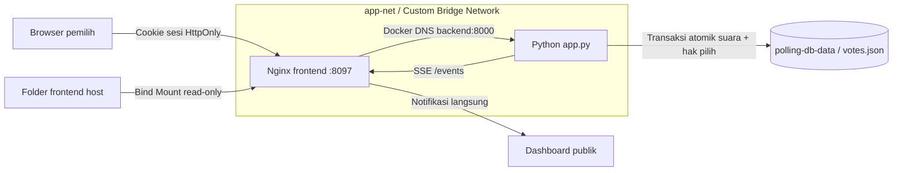
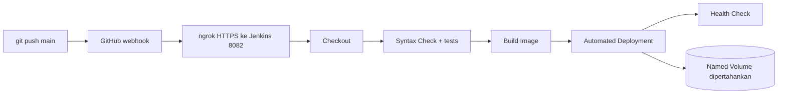

# Tel-U Campus Vote · Bandung

Sistem voting kampus untuk proyek Cloud Computing, studi kasus 7. Backend Python standard library, frontend HTML/CSS/Vanilla JavaScript melalui Nginx, Docker Compose, Named Volume `polling-db-data`, dan pembaruan langsung SSE.

## Mulai

Prasyarat: Docker Desktop dengan Linux containers atau Docker Engine + Compose yang mendukung `--wait`, serta Python 3.12+ untuk helper lokal. Runtime Python aplikasi tersedia di image Docker.

Di folder proyek:

```sh
python tools/setup_secrets.py
docker compose up -d --build --wait
```

Buka:

- Login: <http://localhost:8097/login.html>
- Bilik suara: <http://localhost:8097/index.html> — dialihkan ke login jika belum ada sesi.
- Dashboard publik: <http://localhost:8097/dashboard.html>
- Health: <http://localhost:8097/health>

Login menggunakan NIM **12 digit**, tepat `1010` + delapan angka, contoh `101012345678`. Password bersama adalah **`12345678`**. Tidak ada daftar NIM terdaftar: semua NIM yang memenuhi format dapat login.

Satu NIM hanya dapat berhasil memilih sekali. Sesudah memilih, bilik menampilkan:

> terimakasih sudah menggunakan hak pilih anda, hak pilih anda sangat berguna bagi Universitas ini

Tanggal/jam berasal dari server dan ditampilkan dalam WIB. Tombol pengiriman terkunci. Logout, perangkat lain, penghapusan suara, restart, dan deployment tidak membuka hak pilih kembali.

**Batas identitas:** password bersama dan NIM berformat bebas tidak membuktikan bahwa pengguna adalah pemilik NIM atau mahasiswa aktif. Ini bukan integrasi SSO kampus atau verifikasi resmi. Tidak tersedia DPT untuk menghitung tingkat partisipasi seluruh mahasiswa.

## Anggota kelompok

| Nama | NIM | Tanggung jawab |
| --- | --- | --- |
| Isi nama anggota 1 | Isi NIM | Backend & validasi |
| Isi nama anggota 2 | Isi NIM | Frontend & dashboard |
| Isi nama anggota 3 | Isi NIM | Docker & CI/CD |
| Isi nama anggota 4 (opsional) | Isi NIM | Dokumentasi & demo |

Footer login, bilik, dan dashboard: **made by: Steven Romallo**.

## Desain dan lokasi

- Dua keluarga font lokal: **Outfit** untuk judul/nama kandidat/angka dan **Plus Jakarta Sans** untuk isi. Lisensi OFL tersedia di `frontend/assets/fonts/`.
- Gradasi merah–ungu, kartu statistik berwarna, donat SVG, grafik tren, dan animasi angka tabular tetap dipertahankan.
- Paslon 01 (API `A`): **Fajar Hafiz** — Calon Ketua BEM; **M Dzikran (Zico)** — Calon Wakil Ketua BEM.
- Paslon 02 (API `B`): **M Ridho “Idoy”** — Calon Ketua BEM; **M. Fauzan** — Calon Wakil Ketua BEM.
- Visi-misi tetap merupakan contoh simulasi; materi visual bukan bukti pencalonan resmi.
- Aplikasi khusus **Telkom University Bandung**. Tidak ada dropdown/filter/grafik/pengelompokan lintas kampus. Suara baru ditetapkan backend ke Bandung; kiriman yang mencoba lokasi lain ditolak.
- Katalog fakultas/prodi di `config.json` adalah konfigurasi contoh, bukan daftar resmi atau lengkap universitas. Prodi mengikuti fakultas. Ubah katalog dengan memperhatikan kompatibilitas catatan lama.

## Identitas dan foto kandidat

Nama pasangan, jabatan, nomor, dan path foto terpusat di `config.json` (`candidates[].people` dan `candidates[].assets`). Foto pasangan transparan tampil pada kartu voting dan thumbnail hasil; poster dibuka melalui tombol **Lihat poster**, dapat ditutup dengan Escape, lalu fokus kembali ke tombol pembuka. Nama serta jabatan juga berupa teks HTML.

Delapan PNG dari `tel-u-visual-kandidat.zip` disalin tanpa perubahan wajah atau isi gambar ke `frontend/assets/candidates/`. Materi merupakan visual simulasi akademik, bukan bukti pencalonan resmi. Visi-misi demonstrasi tetap dipertahankan. Rincian pemetaan dan asal aset: [CANDIDATES.md](docs/CANDIDATES.md).

**Catatan historis:** ini adalah penggantian label kandidat A/B pada pemilihan yang sama. Suara A yang sudah tersimpan akan ditampilkan sebagai Fajar Hafiz & M Dzikran, dan suara B sebagai M Ridho “Idoy” & M. Fauzan. Perubahan ini tidak menciptakan pemilihan baru, tidak menghapus suara, dan tidak membuka kembali hak pilih NIM.

Jalankan `python tools/check_candidate_assets.py` untuk memeriksa pemetaan A/B dan kelengkapan gambar lokal. Jenkins menjalankannya pada stage Syntax Check. Backend/config memerlukan rebuild image; folder frontend termasuk seluruh PNG disalin oleh `prepare_deploy.py` ke Bind Mount persisten. Konfigurasi Compose dan nama volume tetap sama.

## Arsitektur aplikasi



Frontend dan backend berjalan sebagai dua layanan terpisah dalam `app-net`. JavaScript menggunakan URL relatif `/auth/...`, `/votes`, dan `/events`. Hostname internal `backend` hanya dipakai Nginx, bukan browser.

Frontend di-Bind Mount ke `/usr/share/nginx/html`; perubahan HTML/CSS/JS di host terlihat setelah halaman dimuat ulang tanpa rebuild frontend. Backend/config berada dalam image, sehingga perubahan keduanya membutuhkan rebuild. Nginx meneruskan Host **beserta port** untuk validasi Origin dan menonaktifkan buffering untuk SSE. DNS backend diselesaikan ulang setelah pergantian kontainer.

Port aplikasi default 8097 dan hanya bind loopback. Port backend tidak diterbitkan langsung ke host. Untuk mengubah port, ubah `APP_PORT` di `.env` lalu jalankan Compose kembali.

## Secret dan sesi

`tools/setup_secrets.py` membuat `.env` lokal yang diabaikan Git. Menjalankannya lagi mempertahankan nilai yang sudah ada. File `.env` aktual tidak disertakan ZIP.

| Variabel | Fungsi |
| --- | --- |
| `NIM_HMAC_SECRET` | Secret acak persisten untuk HMAC-SHA-256 NIM; minimal 32 karakter |
| `LOGIN_PASSWORD` | Password pemilih, default sesuai permintaan `12345678` |
| `ADMIN_TOKEN` | Token operator terpisah untuk DELETE dan seed demo |
| `COOKIE_SECURE` | Set `true` untuk deployment HTTPS |
| `APP_PORT` | Port frontend, default 8097 |
| `ENABLE_DEMO_TOOLS` | Default false; aktifkan untuk seed data demonstrasi |

**Simpan backup `.env` secara privat bersama backup volume.** Memakai volume lama dengan secret NIM berbeda membuat backend menolak startup; penanda hak pilih tidak direset. Jangan mengganti key setiap build atau membuat key baru sebagai cara memperbaiki data.

Sesi memakai token acak, hanya hash token yang disimpan dalam memori backend. Cookie memiliki HttpOnly, SameSite=Lax, Path=/, dan usia maksimal 8 jam. Secure aktif jika `COOKIE_SECURE=true` atau proxy HTTPS yang benar meneruskan protokol tersebut. CSRF token diperiksa pada pengiriman suara dan logout. Permintaan mutasi lintas origin ditolak.

Restart menghapus sesi memori sehingga pengguna perlu login kembali, tetapi **status hak pilih tetap ada**. Browser tidak menyimpan token/password dalam localStorage. Identitas untuk POST suara diambil dari sesi, bukan NIM dalam body permintaan.

## Penyimpanan dan migrasi

Data berada di `/var/lib/backend_data/votes.json` dalam Named Volume yang bernama eksplisit `polling-db-data`.

Format skematis versi 2:

```json
{
  "schema_version": 2,
  "hmac_key_id": "fingerprint-pemeriksaan-key",
  "votes": [
    {
      "option": "A",
      "faculty": "Informatika",
      "program": "S1 Informatika",
      "cohort": 2024,
      "campus": "Bandung",
      "id": "UUID-acak",
      "created_at": "2026-11-04T12:00:00Z",
      "is_demo": false
    }
  ],
  "used_nims": {
    "digest-HMAC-64-karakter": {"voted_at": "2026-11-04T12:00:00Z"}
  }
}
```

Ini ilustrasi struktur, bukan file siap impor. NIM asli tidak disimpan. Field identitas tambahan pada POST diabaikan. Ledger hanya menyimpan digest dan waktu pemilihan pertama, tanpa pilihan atau UUID suara.

Pemeriksaan duplikat, validasi, penambahan suara, dan pencatatan waktu memakai satu `RLock`, kemudian satu atomic file replace. File sementara di-flush dan di-fsync sebelum `os.replace`. Jika simpan gagal, suara dan penanda tidak dianggap berhasil. Permintaan bersamaan untuk NIM yang sama menghasilkan tepat satu keberhasilan.

DELETE menghapus catatan suara saja, **bukan ledger NIM**. Tidak ada endpoint publik untuk mereset hak pilih. File rusak dilaporkan sebagai error dan tidak direset diam-diam. Jalankan satu proses backend per volume; ini tidak dirancang untuk beberapa replica penulis.

### Data lama

File array versi lama divalidasi, disalin ke backup `votes.legacy-<id>.json` dalam volume yang sama, lalu dimigrasikan secara atomik. Catatan lama tidak dihapus atau diberi NIM buatan. Karena identitasnya tidak diketahui, pembatasan NIM tidak dapat diterapkan secara retrospektif pada catatan lama tersebut.

Catatan historis dari luar Bandung tetap disimpan, tetapi dikecualikan dari seluruh hasil/filter/grafik/dashboard Bandung. API mengembalikan `historical_excluded` dan antarmuka memberi keterangan jumlah yang dikecualikan. Indeks catatan tetap mengacu posisi asli dalam file.

## Privasi dashboard

- Dashboard dan SSE tetap dapat diakses tanpa login.
- API publik hanya mengirim catatan berupa `id`, alias acak, `index`, `created_at`, dan `is_demo`.
- Nama, NIM, digest, serta hubungan identitas dengan pilihan tidak dikirim ke dashboard, CSV, atau SSE.
- Nama panggilan opsional hanya dipakai dalam tinjauan lokal dan dibersihkan sesudah berhasil; tidak dikirim ke server.
- Data profil dan pilihan individu berada dalam storage internal untuk agregasi, bukan pada daftar publik.
- Log tidak mencatat body, query, NIM, cookie, password, atau header token.
- Statistik kelompok kecil dan kombinasi filter tetap dapat mendukung inferensi. Alias merupakan pseudonimisasi, bukan jaminan anonimitas mutlak.

## API

Semua URL di bawah menggunakan origin frontend.

| Metode / path | Fungsi | Akses |
| --- | --- | --- |
| `POST /auth/login` | Login NIM/password dan buat sesi | Publik |
| `GET /auth/me` | Status hak pilih/waktu/CSRF milik sesi sendiri | Sesi |
| `POST /auth/logout` | Batalkan sesi | Sesi + CSRF |
| `GET /config` | Kandidat dan katalog profil Bandung | Publik |
| `GET /votes` | Agregat, tren, dan daftar tersamarkan | Publik |
| `POST /votes` | Kirim suara, sekali per NIM sesi | Sesi + CSRF |
| `DELETE /votes?index=X&id=UUID` | Hapus catatan, pertahankan hak pilih terpakai | Token operator |
| `GET /events` | SSE notifikasi perubahan | Publik |
| `GET /health` | Validasi penyimpanan | Publik |
| `POST /demo-votes` | Isi fixture pada storage kosong | Token operator + mode demo |

Login:

```json
{"nim":"101012345678","password":"12345678"}
```

Respons sukses menetapkan cookie dan mengembalikan `authenticated`, `has_voted`, `voted_at`, `message`, serta `csrf_token`. Tidak mengembalikan NIM atau digest. Jangan mencetak cookie atau respons CSRF pada log.

POST `/votes` dengan cookie sesi dan header `X-CSRF-Token`:

```json
{"option":"A","faculty":"Informatika","program":"S1 Informatika","cohort":2024}
```

Server menetapkan kampus Bandung. Body NIM tidak dapat mengganti identitas sesi. Respons 201 memuat status, waktu server, dan bukti alias; respons 409 memuat `has_voted: true`, waktu pemilihan pertama, serta pesan terima kasih agar UI segera terkunci.

DELETE memerlukan `X-Admin-Token`. UUID opsional sesuai API tugas, tetapi frontend selalu menyertakannya agar indeks yang bergeser ditolak dengan 409. Login pemilih tidak memberi hak operator.

Filter GET: `faculty`, `program`, `cohort`, `from`, `to`. Waktu harus ISO 8601 dengan zona waktu, rentang inklusif. Input waktu UI ditafsirkan sebagai WIB. Filter `campus` tidak tersedia. Respons memuat `summary`, `groups`, `trend`, `votes`, `filters`, `storage_total`, `historical_excluded`, dan `generated_at`.

Error: 400 validasi/JSON, 401 sesi/password, 403 CSRF/origin/operator, 404 catatan/path, 405 metode, 409 hak pilih terpakai/indeks bergeser/seed tidak kosong, 413 payload terlalu besar, 415 tipe konten, 500 storage. Batas body 64 KiB.

## SSE dan perhitungan

SSE `/events` hanya membawa token revisi, tanpa identitas atau isi suara. Setelah transaksi berhasil, condition variable membangunkan sambungan dan browser mengambil agregat terbaru. Tidak ada polling hasil berkala. Duplikat yang ditolak tidak mengubah revisi atau jumlah suara.

Keepalive hanya menjaga sambungan dan tidak memicu GET hasil. Setelah putus/restart, browser tersambung ulang dan menyelaraskan hasil terkini. Data terakhir dipertahankan dengan indikator koneksi.

| Angka | Perhitungan |
| --- | --- |
| Persentase kandidat | Suara kandidat dalam filter / total suara dalam filter |
| Persentase dalam kelompok | Suara kandidat pada kelompok / total kelompok |
| Kontribusi kelompok | Total kelompok / total suara dalam filter |

Hasil kosong menghasilkan 0%, tanpa pemenang. Hasil sama menampilkan seri. Pembulatan dapat menyebabkan selisih kecil pada total tampilan. Tren memakai jam, atau hari untuk rentang panjang, termasuk interval tanpa suara. Tidak ada persentase partisipasi seluruh mahasiswa tanpa DPT.

## Data demo dan pengelolaan

Data utama tidak diisi otomatis. Untuk demo terpisah, aktifkan `ENABLE_DEMO_TOOLS=true` pada konfigurasi stack demo. Seed hanya diizinkan jika daftar suara dan ledger hak pilih masih kosong.

```sh
python tools/seed_demo.py --url http://127.0.0.1:8137 --confirm
```

Helper membaca token operator dari `.env` tanpa mencetaknya. Hasilnya 120 catatan fiktif Bandung, A=72 dan B=48, semuanya `is_demo=true`. Fixture tidak memakai NIM mahasiswa dan tidak mencadangkan NIM nyata.

Operator juga dapat mengisi token dari `ADMIN_TOKEN` lokal ke Area pengelolaan dashboard. Token hanya berada pada input/memori tab, tidak di-localStorage. Pengguna biasa tidak perlu membuka bagian ini.

## Pengujian terpisah

```sh
python -m unittest discover -s tests -v
node --check frontend/common.js
node --check frontend/login.js
node --check frontend/vote.js
node --check frontend/dashboard.js
docker compose config --quiet
python tools/health_check.py
```

Unit/integration tests memakai direktori sementara, key khusus pengujian, dan NIM sintetis. Tidak menyentuh data utama. Node hanya untuk syntax check, bukan dependensi runtime.

Contoh `docker-compose.qa.yml` khusus pengujian (gunakan port yang kosong):

```yaml
services:
  backend:
    environment:
      ENABLE_DEMO_TOOLS: 'true'
  frontend:
    ports: !override
      - '127.0.0.1:8137:80'
networks:
  app-net:
    name: telu-auth-qa-net-local
volumes:
  polling-db-data:
    name: telu-auth-qa-data-local
```

```sh
docker compose -p telu-auth-qa -f docker-compose.yml -f docker-compose.qa.yml up -d --no-build --wait
python tools/verify_live.py --url http://127.0.0.1:8137 --confirm-test-vote
python tools/verify_docker.py --url http://127.0.0.1:8137 --project telu-auth-qa --compose-override docker-compose.qa.yml --confirm-container-recreate
```

Helper Docker menolak volume utama `polling-db-data`. Ia membuat tepat satu suara uji, membuat ulang backend QA, login kembali, membuktikan waktu/status bertahan serta duplikat ditolak, lalu menghapus hanya UUID uji. Ledger NIM uji sengaja tetap terkunci. Karena itu jalankan helper mutasi hanya pada stack QA terpisah.

Pratinjau tanpa Docker:

```sh
python tools/run_local.py --port 8765 --data-dir data
```

Mode ini untuk pengembangan; demo arsitektur tugas memakai Docker/Nginx. Hasil pemeriksaan aktual tercantum di `docs/VERIFICATION.md`.

## Jenkins, GitHub, ngrok

Instance khusus proyek tersedia melalui konfigurasi di [jenkins/README.md](jenkins/README.md), terpisah dari Jenkins proyek lain: **http://localhost:8082**. Username/password dibuat sendiri melalui setup awal; tidak ada password akun yang ditulis dalam source. Untuk instance ini gunakan `ngrok http 8082` dan nilai `DEPLOY_DIR` yang dicetak bootstrap, bukan default `/srv/telu-campus-vote`. Panduan berikut juga berlaku bagi instalasi Jenkins lain dengan port/path yang disesuaikan.



Jenkinsfile menggunakan agent Linux dengan Python 3, Git, Docker CLI/Compose, dan akses daemon yang menjalankan stack. Plugin: Pipeline, Git, GitHub, Timestamper, dan Credentials Binding.

### Credentials

| ID Jenkins | Jenis | Isi |
| --- | --- | --- |
| `github-pat` | Username with password | Username GitHub + PAT sesuai ketentuan tugas |
| `telu-nim-hmac` | Secret text | Nilai **yang sama** dengan NIM_HMAC_SECRET deployment yang ada |
| `telu-admin-token` | Secret text | ADMIN_TOKEN operator |
| `telu-voter-password` | Secret text | `12345678` |

Jangan membuat ulang key di pipeline. Environment Credentials disamarkan oleh Jenkins. Jangan menjalankan `docker compose config` tanpa `--quiet` pada log karena output lengkap dapat memuat nilai environment. Helper deployment tidak mencetak secret dan menolak jika key berbeda dari konfigurasi deployment sebelumnya.

### Job dan webhook

1. Push folder proyek ke repository kelompok dengan branch `main` dan Jenkinsfile di root.
2. Buat Pipeline script from SCM → Git, URL HTTPS repository, credential GitHub PAT, branch `*/main`, script path `Jenkinsfile`.
3. Isi Credentials di atas. Jalankan build awal agar trigger/parameter terdaftar.
4. Jalankan `ngrok http 8082` pada host yang dapat mengakses Jenkins khusus proyek ini.
5. GitHub → Settings → Webhooks: Payload URL `https://ALAMAT-NGROK/github-webhook/`, content type JSON, push event, Active.
6. Pastikan GitHub hook trigger for GITScm polling aktif. Ubah kode dan push main; periksa Recent Deliveries dan lima stage Jenkins.

PAT classic mengikuti PDF: expiry 30/90 hari, izin `repo` dan `admin:repo_hook`. Jangan menaruh PAT pada source atau URL remote. Pertahankan autentikasi Jenkins saat memakai tunnel.

### Folder deployment dan Bind Mount

- Workspace Jenkins adalah tempat checkout, tests, dan build.
- `DEPLOY_DIR` default `/var/lib/docker/volumes/telu-jenkins-deploy/_data` adalah folder persisten, berbeda dari workspace, untuk Jenkins khusus proyek ini.
- Jika agent berada dalam kontainer Linux, mount folder host deployment ke **path identik** dalam agent dan beri izin tulis. Agent memerlukan Docker CLI/Compose dan akses socket daemon yang sama.
- Bind Mount diselesaikan pada host daemon, bukan filesystem client Jenkins. Jangan menunjuk folder yang hanya ada dalam kontainer agent.
- Helper menyalin aset frontend/Nginx dan menulis `.env` runtime deployment secara atomik. File itu berisi secret runtime sehingga harus tetap privat dan tidak masuk source/ZIP.
- Untuk agent host Linux, set Health URL `http://127.0.0.1:8097`. Untuk agent dalam kontainer pada `app-net`, gunakan `http://frontend:80`.
- Docker Desktop Windows tidak otomatis menyamakan `C:\...` dengan `/srv/...`; gunakan agent Linux/VM dengan path identik atau sesuaikan pemetaan secara terpisah.

Build memakai image lokal pada daemon yang sama; deployment memakai `--no-build --force-recreate --wait` tanpa menghapus volume. Tidak ada automatic rollback; kegagalan health check menghentikan pipeline. Pada HTTPS, set `COOKIE_SECURE=true` dan gunakan konfigurasi proxy TLS yang benar.

**Repositori GitHub, job Jenkins, dan ID credential telah disiapkan; build/deployment serta webhook ngrok masih perlu diverifikasi.**

## Panduan demo 5–8 menit

| Waktu | Demonstrasi |
| --- | --- |
| 00:00–00:40 | Kelompok, studi kasus, arsitektur |
| 00:40–02:00 | Login NIM, pilih paslon, kirim suara |
| 02:00–02:50 | Pesan terima kasih, waktu WIB, tombol terkunci; logout/login ulang |
| 02:50–03:40 | Dashboard LIVE, filter fakultas/angkatan, CSV, alias |
| 03:40–04:50 | Buat ulang backend QA; login ulang tetap terkunci |
| 04:50–06:50 | Push main, webhook, lima stage pipeline, versi baru |
| 06:50–07:30 | Health check dan batasan verifikasi identitas |

Kumpulkan tautan repository, README dengan nama/NIM kelompok, dan video aktual. Gunakan stack QA dan identitas sintetis untuk demonstrasi pengujian.

## Referensi dan lisensi aset

Pengujian otomatisasi Jenkins CI/CD menggunakan GitHub Webhook.
- [Outfit — Google Fonts](https://github.com/google/fonts/tree/main/ofl/outfit), [Plus Jakarta Sans — Google Fonts](https://github.com/google/fonts/tree/main/ofl/plusjakartasans). File OFL disertakan.
- [Jenkins GitHub plugin](https://plugins.jenkins.io/github/), [Declarative Pipeline](https://www.jenkins.io/doc/book/pipeline/syntax/).
- [Docker Bind Mount](https://docs.docker.com/engine/storage/bind-mounts/), [ngrok HTTP endpoints](https://ngrok.com/docs/http/).
- [Server-Sent Events](https://developer.mozilla.org/en-US/docs/Web/API/Server-sent_events/Using_server-sent_events).
- Logo Telkom University dan foto kandidat berasal dari aset yang diberikan pengguna. Materi kandidat merupakan visual simulasi akademik, bukan bukti pencalonan resmi.
